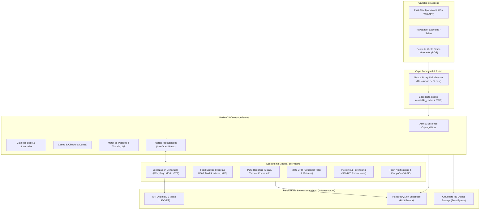
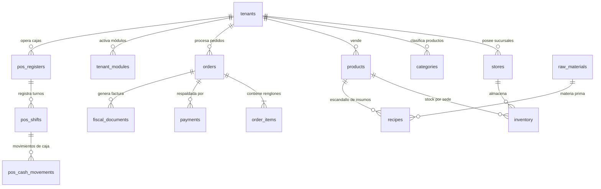
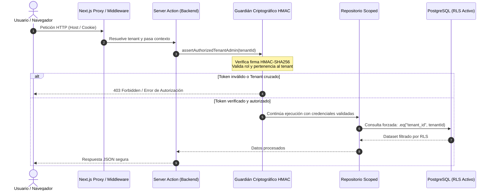
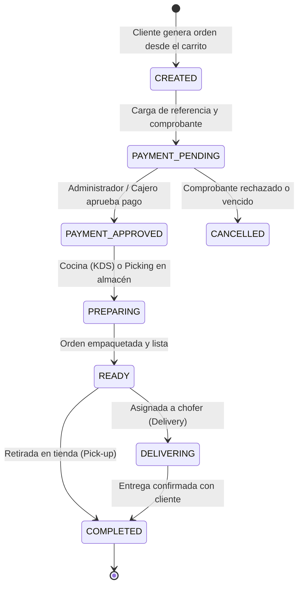

# MarketOS — Documento Maestro de Arquitectura y Especificación Técnica Integral

> **Versión del Sistema**: 2.5.0-production  
> **Patrón Arquitectónico**: Clean Architecture + Arquitectura Hexagonal (Puertos y Adaptadores) + Core Agnóstico con Plugins Modulares (Modelo Odoo / Shopify Apps)  
> **Seguridad y Excelencia**: Estándar AgentShield (ECC) + Ponytail Ultra (Cero Código Muerto, Máxima Simplicidad)  
> **Filosofía de Interfaz**: Mobile-First, PWA Multi-Tenant Aislada, Ergonomía de Pulgar y Cero Fricción Comercial  

---

## Índice General

1. [Visión del Sistema y Principios Rectores](#1-visión-del-sistema-y-principios-rectores)
2. [Estructura del Monorepo (Turborepo + pnpm)](#2-estructura-del-monorepo-turborepo--pnpm)
3. [Arquitectura Hexagonal: Puertos, Adaptadores y Ecosistema de Plugins](#3-arquitectura-hexagonal-puertos-adaptadores-y-ecosistema-de-plugins)
4. [Base de Datos & Modelado Relacional (28 Migraciones SQL)](#4-base-de-datos--modelado-relacional-28-migraciones-sql)
5. [Seguridad Integral y Aislamiento Multi-Tenant (AgentShield)](#5-seguridad-integral-y-aislamiento-multi-tenant-agentshield)
6. [Flujos Críticos de Negocio y Ciclo de Vida](#6-flujos-críticos-de-negocio-y-ciclo-de-vida)
7. [Arquitectura Frontend, Mobile-First y PWA Multi-Tenant](#7-arquitectura-frontend-mobile-first-y-pwa-multi-tenant)
8. [Conexiones Externas, APIs y Servicios de Infraestructura](#8-conexiones-externas-apis-y-servicios-de-infraestructura)
9. [Guía de Despliegue, Variables de Entorno y Operaciones](#9-guía-de-despliegue-variables-de-entorno-y-operaciones)

---

## 1. Visión del Sistema y Principios Rectores

MarketOS es una **plataforma SaaS de comercio digital y operaciones omnicanal multi-inquilino**, concebida para permitir que negocios independientes (minimarkets, restaurantes, tiendas de moda, talleres y retail general) operen como si dispusieran de una aplicación propietaria de alta gama, manteniendo una infraestructura unificada y costes operacionales prácticamente nulos (*Low-Cost / Zero-Egress*).



### Principios Fundamentales de Diseño

#### A. Clean Architecture & Principios SOLID
1. **Single Responsibility (SRP)**: Cada paquete, repositorio y Server Action tiene una única causa de modificación. Los repositorios de datos no manipulan HTTP ni cookies; los componentes visuales no ejecutan consultas SQL directas.
2. **Open/Closed (OCP)**: El Core de la plataforma no se modifica para añadir soporte a un país nuevo o a un modelo de negocio específico (e.g. comida rápida vs. supermercados). Toda extensión se realiza creando un plugin que implementa los puertos definidos en [`packages/types/src/ports.ts`](file:///home/lmontes/Documentos/Telegram/Market/packages/types/src/ports.ts).
3. **Liskov Substitution (LSP)**: Cualquier adaptador que cumpla el contrato de un puerto (e.g., `PaymentPort` o `FiscalAdapterPort`) puede sustituir a otro sin alterar la lógica de despacho de órdenes.
4. **Interface Segregation (ISP)**: Los puertos están divididos por capacidades atómicas (`PaymentPort`, `ExchangeRatePort`, `InventoryPort`, `NotificationPort`, `FiscalAdapterPort`). Un plugin de pasarelas de pago no está obligado a conocer sobre inventario ni impuestos.
5. **Dependency Inversion (DIP)**: Los módulos de alto nivel (como el procesamiento de un checkout en `apps/web`) dependen de abstracciones tipadas en TypeScript, mientras que las implementaciones concretas residen en paquetes adaptadores o plugins.

#### B. Core Agnóstico y Modelo Odoo / Shopify Apps
- **El Core no conoce de bancos, divisas fijas ni giros específicos**: No contiene cadenas como `"Banesco"`, `"Pago Móvil"`, `"Salsas"` ni `"Recetas"`.
- **Activación Dinámica por Base de Datos**: Cada comercio (*Tenant*) tiene su propia lista de módulos activos en la tabla `tenant_modules`. Si un comercio no activa `food_service`, su interfaz y sus consultas SQL no cargan modificadores de cocina ni generan sobrecostes de renderizado.

#### C. Eficiencia Operativa Extrema (Zero-Egress & Low-Cost)
- **Frontend / Serverless**: Next.js 16 desplegado en Vercel (Edge Runtime y Node Serverless).
- **Base de Datos**: PostgreSQL en Supabase con Row-Level Security (RLS) mandatorio e indexación B-Tree/GIN de alto impacto.
- **Almacenamiento de Archivos**: Cloudflare R2 (compatible con API S3, con 10 GB de almacenamiento gratuito y **cero coste por transferencia saliente / zero egress**).
- **Caché en Capa Edge**: [`unstable_cache`](file:///home/lmontes/Documentos/Telegram/Market/apps/web/src/lib/cached-queries.ts) de Next.js con SWR e invalidación bajo demanda con tags (`revalidateTag`), reduciendo drásticamente las lecturas a PostgreSQL (<15 ms en peticiones repetidas).

---

## 2. Estructura del Monorepo (Turborepo + pnpm)

El proyecto está organizado como un monorepo administrado mediante **Turborepo** y **pnpm workspaces**:

```
Market/
├── apps/
│   └── web/                                # Aplicación Next.js 16 (App Router)
│       ├── public/                         # Assets estáticos globales y Service Worker
│       └── src/
│           ├── app/                        # Rutas canónicas (Storefront, Admin, APIs)
│           │   ├── actions.ts              # Server Actions públicas (checkout, rastreo)
│           │   ├── admin/                  # Panel de administración del comercio (/admin)
│           │   │   ├── actions.ts          # Server Actions administrativas blindadas
│           │   │   ├── pos/                # Pantalla táctil del POS (/admin/pos)
│           │   │   ├── pos-actions.ts      # Server Actions para cajas y turnos
│           │   │   ├── invoicing-actions.ts# Facturación fiscal SENIAT / PAC
│           │   │   ├── purchasing-actions.ts# Compras y retenciones de proveedores
│           │   │   └── push-actions.ts     # Campañas y notificaciones Web Push
│           │   ├── api/                    # Endpoints REST y Webhooks
│           │   │   ├── analytics/          # Registro de tráfico y métricas en vivo
│           │   │   ├── cron/               # Tareas programadas (Sincronización BCV)
│           │   │   ├── manifest/           # Web App Manifest PWA dinámico por tenant
│           │   │   └── media/              # Subida de comprobantes y fotos a R2
│           │   ├── platform/               # Panel del Super Administrador (/platform)
│           │   ├── t/[tenant]/             # Storefront canónico aislado por ruta
│           │   └── proxy.ts                # Detección y reescritura de subdominios
│           ├── components/                 # Componentes UI (Storefront, Checkout, POS)
│           ├── context/                    # Contextos de React (Carrito, Favoritos)
│           └── lib/                        # Clientes de caché, compresión y Excel
├── packages/
│   ├── auth/                               # Seguridad, roles RBAC y sesiones HMAC
│   ├── database/                           # Repositorios, migraciones SQL y Circuit Breaker
│   │   └── supabase/
│   │       ├── migrations/                 # 30 migraciones SQL versionadas
│   │       └── PRODUCTION_FULL_SETUP.sql   # DDL consolidado de producción
│   ├── plugins/                            # Ecosistema de 14 plugins modulares
│   │   ├── accounting/                     # Contabilidad NIIF y Plan Único de Cuentas
│   │   ├── analytics/                      # Métricas de tráfico, fuentes y conversión
│   │   ├── barcode-retail/                 # Códigos EAN-13, pasillos y balanzas
│   │   ├── delivery-fleet/                 # Asignación de motorizados y tarifas por km
│   │   ├── food-service/                   # Recetas BOM, modificadores y comandas KDS
│   │   ├── invoicing/                      # Facturas, notas, Libro de Ventas SENIAT
│   │   ├── local-venezuela/                # Pago Móvil, tasa BCV en vivo e IGTF
│   │   ├── mto-cpq/                        # Cotizador Make-to-Order para talleres
│   │   ├── promotions-coupons/             # Cupones de descuento y promociones
│   │   ├── purchasing-retentions/          # Facturas de compra y retenciones IVA
│   │   ├── push-notifications/             # Notificaciones masivas Web Push VAPID
│   │   └── storefront-pro/                 # Maquetador modular de 11 bloques visuales
│   ├── types/                              # Definiciones TypeScript y Puertos Hexagonales
│   ├── ui/                                 # Librería de componentes (Tailwind + Radix)
│   └── utils/                              # Utilidades de R2, fechas, WhatsApp y plugins
└── package.json                            # Scripts globales de compilación y pruebas
```

---

## 3. Arquitectura Hexagonal: Puertos, Adaptadores y Ecosistema de Plugins

Toda integración externa o variación por modelo de negocio se implementa desacoplando el Core mediante **Puertos** definidos en [`packages/types/src/ports.ts`](file:///home/lmontes/Documentos/Telegram/Market/packages/types/src/ports.ts):

### Puertos Principales del Sistema

```typescript
// 1. PUERTO DE PAGOS (Intercambiable entre Pago Móvil, Zelle, Stripe, Tarjetas)
export interface PaymentPort {
  readonly providerId: string;
  processPayment(input: PaymentProcessInput): Promise<PaymentProcessResult>;
  verifyPayment?(transactionId: string): Promise<PaymentProcessResult>;
}

// 2. PUERTO DE TASA DE CAMBIO (Sincronización BCV, TRM Colombia, Tipos Globales)
export interface ExchangeRatePort {
  readonly providerId: string;
  getRate(from: CurrencyCode, to: CurrencyCode, tenantId?: string): Promise<ExchangeRateResult>;
}

// 3. PUERTO DE INVENTARIO (Descarga directa 1 a 1 o Escandallo de Recetas BOM)
export interface InventoryPort {
  readonly strategyId: string;
  deductStock(input: InventoryDeductInput): Promise<InventoryDeductResult>;
  restoreStock(input: InventoryRestoreInput): Promise<void>;
}

// 4. PUERTO DE NOTIFICACIONES (WhatsApp, SMS, Correo Transaccional)
export interface NotificationPort {
  readonly channelId: string;
  sendNotification(payload: NotificationPayload): Promise<NotificationResult>;
}

// 5. PUERTO FISCAL Y TRIBUTARIO (SENIAT Venezuela, DIAN Colombia, Global)
export interface FiscalAdapterPort {
  readonly countryCode: string;
  readonly countryName: string;
  readonly taxIdLabel: string;
  readonly defaultIvaRate: number;
  validateTaxId(taxId: string): boolean;
  calculateTaxes(input: FiscalCalculationInput): FiscalCalculationBreakdown;
  formatDocumentNumber(type: string, sequence: number, prefix?: string): string;
  getLegalLegend(type: string): string;
}
```

### Motor de Resolución de Dependencias y Conflictos

El motor en [`packages/utils/src/plugin-resolver.ts`](file:///home/lmontes/Documentos/Telegram/Market/packages/utils/src/plugin-resolver.ts) gestiona el ciclo de vida de los módulos evitando inconsistencias tributarias o de negocio:
- **Activación en Cascada (`REQUIRES` / `AUTO_ACTIVATE`)**: Activar un módulo avanzado (ej. `invoicing`) activa de forma automática sus dependencias requeridas (ej. `local_venezuela`).
- **Desactivación en Cascada**: Desactivar un módulo base apaga de forma segura todos los módulos superiores dependientes.
- **Resolución de Conflictos Territoriales (`CONFLICTS`)**: Evita que un comercio active simultáneamente localizaciones mutuamente excluyentes (como `local_venezuela` y `local_colombia`).

### Desacoplamiento de Vitrina: Retail de 1 Clic vs Fabricación CPQ

Para evitar choques operativos entre comercios de consumo masivo (**Shop Market**, retail/minimarket) y talleres de personalización (**Printo Prink**, sublimación/imprenta), el Storefront discrimina dinámicamente la experiencia de compra según las capacidades del producto:

1. **Retail Inmediato (1-Click Add-to-Cart)**:
   - Para productos sin modificadores gastronómicos ni ficha de personalización, el botón agrega directamente al carrito con la cantidad deseada.
   - Valida el inventario físico en tiempo real (`inventory.quantity`).

2. **Personalización y Cotización CPQ (`mto_cpq`)**:
   - Detecta si el producto cuenta con matrices de atributos o el plugin `mto_cpq` está activo (`hasCpq: true`).
   - El botón transmuta automáticamente a **"Personalizar / Cotizar"** (estilo índigo de taller).
   - Abre el modal `CpqModal` (envoltorio de `CustomProductConfigurator`), permitiendo al usuario configurar dimensiones ($cm \times cm$), técnica de estampado, material base, porcentaje de anticipo y subir su arte o logotipo.
   - En el carrito (`CartItem.is_cpq`), se respeta el precio unitario dinámico cotizado y se omite la restricción de stock fijo en estante (Make-to-Order).
   - En el backend (`order.repository.ts`), las líneas CPQ conservan su precio cotizado y no bloquean el pedido por inexistencia en anaquel.

---

## 4. Base de Datos & Modelado Relacional (30 Migraciones SQL y RPCs Transaccionales)

La base de datos reside en **PostgreSQL (Supabase)**, con tipado estricto, integridad referencial en cascada, auditoría inmutable, procedimientos almacenados transaccionales (RPC) y Row-Level Security (RLS) en el 100% de las tablas.

### Catálogo Cronológico de las 30 Migraciones

| Migración | Nombre / Identificador | Propósito Arquitectónico y Tablas Creadas |
| :---: | :--- | :--- |
| **00001** | `initial_schema.sql` | Fundamentos: `tenants`, `tenant_settings`, `stores`, `profiles`, `categories`, `products`, `inventory`, `orders`, `order_items`, `payments`, `audit_logs`. |
| **00002** | `seed_shop_market.sql` | Datos semilla para el primer tenant piloto: **Shop Market C.A.** (Nueva Segovia, Barquisimeto). |
| **00003** | `phase_2_operational.sql` | Operaciones: `coupons`, `delivery_zones`, `drivers`, soporte de trazabilidad operativa. |
| **00004** | `phase_3_saas_multi_tenant.sql` | SaaS: Planes de suscripción, límites de productos y sucursales por tenant. |
| **00005** | `phase_4_production_hardening.sql` | Triggers automáticos para actualizar `updated_at` y restricciones de consistencia. |
| **00006** | `auth_roles_profiles.sql` | RBAC: Definición del enum `app_role` y sincronización bidireccional con `auth.users`. |
| **00007** | `supabase_cron_bcv_sync.sql` | Automatización: Configuración de `pg_cron` y `pg_net` para sincronizar la tasa BCV vía API. |
| **00008** | `exchange_rate_history.sql` | Auditoría de divisas: Tabla `exchange_rate_history` con tasa histórica para cierres contables. |
| **00009** | `tenant_brand_and_payment_settings.sql` | Identidad: Configuración visual y pasarelas de pago habilitadas (Pago Móvil, Zelle, Efectivo). |
| **00010** | `push_notifications.sql` | PWA Push: `push_subscriptions` (VAPID) y `push_notification_logs` para envíos masivos. |
| **00011** | `customer_id_number_ci_rif.sql` | Identificación fiscal: Agrega `id_number` (Cédula / RIF) en perfiles y clientes. |
| **00012** | `fiscal_billing_settings.sql` | Facturación: Parámetros de IGTF (3%), alícuota general de IVA y RIF de la empresa. |
| **00013** | `custom_domains.sql` | Multitenancy avanzado: Columna `custom_domain` con índice único en `tenants`. |
| **00014** | `global_audit_trail_hardening.sql` | Trazabilidad inmutable: Registros forenses con dirección IP, User-Agent y metadatos JSONB. |
| **00015** | `tenant_modules_and_food_service.sql` | Módulos y Restaurantes: `tenant_modules`, `raw_materials`, `recipes`, `product_modifier_groups`, `product_modifiers`. |
| **00016** | `platform_settings.sql` | Configuración global del Super Administrador: pasarelas maestras y switch de mantenimiento. |
| **00017** | `mto_cpq_engine.sql` | Fabricación bajo pedido: `cpq_attribute_matrices`, `cpq_pricing_formulas`, fichas de taller. |
| **00018** | `storefront_pro.sql` | Maquetador de vitrina: Tabla `storefront_blocks` (11 tipos de bloques dinámicos ordenables). |
| **00019** | `tenant_performance_indexes.sql` | Optimización de lectura: Índices compuestos B-Tree y GIN para consultas <10 ms. |
| **00020** | `barcode_retail_engine.sql` | Retail físico: Índices de código de barras EAN-13, gestión de bultos y pasillos de almacén. |
| **00021** | `cpq_configurable_deposit.sql` | Finanzas CPQ: Gestión de porcentajes de anticipo configurables por cotización. |
| **00022** | `food_service_kitchen_hardening.sql` | Cocina KDS: Comandas en tiempo real y estados de preparación para cocineros. |
| **00023** | `pos_registers.sql` | Punto de Venta: `pos_registers`, `pos_shifts` (turnos), `pos_cash_movements`, arqueo ciego, corte X y corte Z. |
| **00024** | `tenant_analytics.sql` | Métricas de negocio: `tenant_page_views`, fuentes de tráfico (WhatsApp, IG) y embudos. |
| **00025** | `fiscal_documents.sql` | Documentos fiscales: `fiscal_documents`, `fiscal_document_items`, Libro de Ventas SENIAT. |
| **00026** | `purchasing_and_retentions.sql` | Compras: `purchase_invoices`, comprobantes de retención IVA (75%/100%) y exportación TXT SENIAT. |
| **00027** | `accounting_and_commissions.sql` | Contabilidad NIIF: `accounting_accounts` (PUC 4 niveles), `journal_entries`, `journal_entry_lines`, comisiones fintech. |
| **00028** | `atomic_fiscal_sequences.sql` | Secuencias legales: `fiscal_sequences` con bloqueo `FOR UPDATE` para numeración consecutiva atómica. |
| **00029** | `schema_cleanup_and_bimonetary.sql` | Poda y Moneda Dual: Eliminación de tablas muertas (`user_profiles`, `mto_quote_requests`, `mto_materials`, `tenant_plan_limits`), soporte fraccionario de pesaje (`NUMERIC(12,3)` en inventario), columnas `primary_currency`/`secondary_currency` y balances duales de caja (`pos_shifts`). |
| **00030** | `core_transactional_rpcs.sql` | Stored Procedures ACID: `rpc_create_order_atomic` (descuento de recetas/stock sin carreras), `rpc_issue_fiscal_document` (bloqueo `FOR UPDATE` SENIAT y asiento doble contable automático), `rpc_close_pos_shift` (arqueo ciego de caja en BD) y `rpc_get_sales_book` (Libro de Ventas instantáneo). |

### Diccionario de Datos: Entidades Principales



1. **`tenants`**: Registro de comercios (`id`, `name`, `slug`, `status`, `custom_domain`).
2. **`tenant_settings`**: Personalización visual y operativa (`business_name`, `primary_color`, `logo_url`, `whatsapp_number`, `supported_currencies`).
3. **`stores`**: Sedes físicas asociadas a un tenant (`id`, `tenant_id`, `name`, `code`, `address`).
4. **`products` & `inventory`**: Catálogo base y existencias segregadas por sucursal (`product_id`, `store_id`, `quantity`).
5. **`orders` & `order_items`**: Pedidos del comercio con desglose de ítems, precios unitarios, tasas de cambio y estado.
6. **`pos_registers` & `pos_shifts`**: Control estricto de puntos de venta físicos, apertura con fondo de caja, arqueo ciego y cortes X/Z.
7. **`fiscal_documents` & `fiscal_sequences`**: Facturación legal con numeración secuencial atómica garantizada sin saltos.

---

## 5. Seguridad Integral y Aislamiento Multi-Tenant (AgentShield)

El estándar **AgentShield (ECC)** implementa una defensa en profundidad de tres capas para garantizar que **ningún comercio pueda acceder, alterar o visualizar información de otro**:



### Reglas Críticas de Seguridad Aplicadas

1. **Sesiones Criptográficas HMAC-SHA256**:
   - Ubicación: [`packages/auth/src/session.ts`](file:///home/lmontes/Documentos/Telegram/Market/packages/auth/src/session.ts).
   - Todo token de sesión viaja como una cookie segura (`httpOnly`, `secure`, `sameSite: lax`).
   - El payload se firma con clave secreta (`SESSION_SECRET`). **Se ha erradicado todo bypass de cadenas JSON no firmadas**. Cualquier token adulterado es revocado automáticamente.

2. **Autorización Obligatoria en Server Actions**:
   - Ubicación: [`apps/web/src/app/admin/actions.ts`](file:///home/lmontes/Documentos/Telegram/Market/apps/web/src/app/admin/actions.ts).
   - Ninguna acción administrativa (modificar inventario, cambiar precios, aprobar pagos, configurar cupones o crear zonas) confía en el `tenantId` enviado por el navegador.
   - Toda mutación pasa por `assertAuthorizedTenantAdmin(tenantId)`:
     ```typescript
     const user = await assertAuthorizedTenantAdmin(tenantId);
     // Solo continúa si user.role === 'PLATFORM_SUPER_ADMIN' o user.tenant_id === tenantId
     ```

3. **Row-Level Security (RLS) Mandatorio en PostgreSQL**:
   - El 100% de las tablas tienen RLS habilitado (`ALTER TABLE ... ENABLE ROW LEVEL SECURITY`).
   - Las lecturas públicas (Storefront) se restringen estrictamente a datos de comercios con `status = 'active'`.
   - Las escrituras quedan limitadas al usuario autenticado con pertenencia válida al `tenant_id`.

4. **Custodia de Claves y Prevención de Fugas de `service_role`**:
   - En [`packages/database/src/server.ts`](file:///home/lmontes/Documentos/Telegram/Market/packages/database/src/server.ts), la clave administrativa `SUPABASE_SERVICE_ROLE_KEY` se lee exclusivamente desde variables de entorno seguras de servidor.
   - Si no está presente, el cliente degrada de forma segura a permisos anónimos.

5. **Supabase Circuit Breaker**:
   - Ubicación: [`packages/database/src/circuit-breaker.ts`](file:///home/lmontes/Documentos/Telegram/Market/packages/database/src/circuit-breaker.ts).
   - Detección de fallos de red o latencias anómalas (>20s) con aislamiento temporal para prevenir cuelgues indefinidos en las funciones serverless de Vercel.

---

## 6. Flujos Críticos de Negocio y Ciclo de Vida

### A. Resolución de Tenant en Tiempo de Ejecución
La resolución del comercio se ejecuta en [`apps/web/src/proxy.ts`](file:///home/lmontes/Documentos/Telegram/Market/apps/web/src/proxy.ts) y [`apps/web/src/app/page.tsx`](file:///home/lmontes/Documentos/Telegram/Market/apps/web/src/app/page.tsx):
1. **Dominio Personalizado**: Si la cabecera `host` es `pedidos.mimercado.com`, el proxy consulta el `custom_domain` en la base de datos.
2. **Subdominio de Plataforma**: Si la cabecera es `mimercado.marketos.app`, extrae `mimercado` como identificador de tenant.
3. **Ruta Canónica Aislada**: En el dominio principal, las peticiones se enrutan de forma canónica hacia `/t/[tenant]` (e.g. `/t/shop-market`), lo cual aísla el contexto del Web App Manifest y permite instalar múltiples tiendas en el mismo dispositivo móvil.

### B. Ciclo de Vida de la Orden de Compra


### C. Motor Cambiario Multi-Moneda y Tasa BCV
- La moneda base de cotización de los productos es **USD**.
- Para operaciones en Venezuela, el sistema consulta la tasa oficial mediante el endpoint de `bcv.today` (`https://bcv.today/api/v1/rate.json`).
- Los valores se almacenan con caché en memoria y respaldo en la tabla `exchange_rates`.
- En el Storefront y el POS, los importes se convierten automáticamente en tiempo real:
  $$\text{Precio en VES} = \text{Precio en USD} \times \text{Tasa BCV del Día}$$
- En caso de pagos en divisas bajo legislación venezolana, el motor aplica de forma automática el cálculo del **3% IGTF**.

---

## 7. Arquitectura Frontend, Mobile-First y PWA Multi-Tenant

El frontend está desarrollado bajo directrices estrictas de **ergonomía móvil**:

### Características Mobile-First
- **Touch Targets Optimizados**: Todas las áreas de interacción táctil tienen dimensiones mínimas de $44 \times 44\,\text{px}$.
- **Ergonomía de Pulgar**: Uso intensivo de *Bottom Sheets* ([`bottom-sheet-modal.tsx`](file:///home/lmontes/Documentos/Telegram/Market/apps/web/src/components/ui/bottom-sheet-modal.tsx)) para selectores de sucursal, filtros, variantes y confirmaciones de compra, ubicando los controles al alcance natural de una sola mano.
- **Rendimiento Perceptual Instantáneo**: React Server Components (RSC) para el renderizado inicial sin JavaScript innecesario en el cliente.
- **Microinteracciones y Feedback Háptico**: Estados inmediatos de carga, confirmación de agregado al carrito y botones directos a WhatsApp formateados con la comanda de la orden.

### PWA Multi-Tenant sin Colisión de WebAPKs
El reto habitual en plataformas SaaS de comercio es que al tener múltiples tiendas bajo el mismo dominio (ej. `marketos.app`), el navegador tiende a sobrescribir la PWA instalada. MarketOS resuelve esto mediante:
1. **Endpoint de Manifiesto Dinámico ([`/api/manifest/route.ts`](file:///home/lmontes/Documentos/Telegram/Market/apps/web/src/app/api/manifest/route.ts))**: Genera un manifiesto W3C parametrizado por tenant con nombre, colores de marca e íconos independientes.
2. **Identificador y Scope Segmentado**:
   ```json
   {
     "id": "/t/shop-market",
     "start_url": "/t/shop-market?source=pwa",
     "scope": "/t/shop-market"
   }
   ```
   Esto permite que un usuario instale simultáneamente la tienda **Shop Market C.A.** y el restaurante **Pulldog** como dos aplicaciones nativas independientes en su pantalla de inicio de Android o iOS.
3. **Modales de Instalación Asistida**: Guías ilustradas paso a paso para iOS (Safari Compartir > Añadir a pantalla de inicio) y Android ([`android-install-guide-modal.tsx`](file:///home/lmontes/Documentos/Telegram/Market/apps/web/src/components/pwa/android-install-guide-modal.tsx)).

---

## 8. Conexiones Externas, APIs y Servicios de Infraestructura

| Servicio / API | Proveedor | Finalidad en MarketOS | Modo de Autenticación / Credenciales |
| :--- | :--- | :--- | :--- |
| **PostgreSQL & Auth** | Supabase | Base de datos relacional, Auth RBAC y RLS. | API URL, Anon Publishable Key y Service Role Key en backend. |
| **Object Storage** | Cloudflare R2 | Almacenamiento S3 de fotos de productos, logos y comprobantes. | `R2_ACCESS_KEY_ID`, `R2_SECRET_ACCESS_KEY`, `R2_BUCKET_NAME`. |
| **Tasa Oficial USD/VES** | BCV Today API | Sincronización diaria del tipo de cambio oficial de Venezuela. | Endpoint público HTTP: `https://bcv.today/api/v1/rate.json`. |
| **Web Push API** | VAPID / W3C | Notificaciones push de marketing y cambios de estado en PWA. | `NEXT_PUBLIC_VAPID_PUBLIC_KEY`, `VAPID_PRIVATE_KEY`. |
| **Impresión Térmica** | ESC/POS Nativo | Impresión directa de tickets de comanda y cortes de caja en 58/80mm. | Conexión WebUSB / Bluetooth en navegador del POS sin drivers externos. |

---

## 9. Guía de Despliegue, Variables de Entorno y Operaciones

### Variables de Entorno Requeridas (`.env.production`)

```bash
# ─── 1. SUPABASE (BASE DE DATOS & AUTH) ──────────────────────────────
NEXT_PUBLIC_SUPABASE_URL="https://tu-proyecto.supabase.co"
NEXT_PUBLIC_SUPABASE_ANON_KEY="tu-clave-publica-anon"
SUPABASE_SERVICE_ROLE_KEY="tu-clave-privada-service-role"

# ─── 2. DOMINIO Y ENRUTAMIENTO MULTI-TENANT ──────────────────────────
NEXT_PUBLIC_PLATFORM_DOMAIN="marketos.app"
DEFAULT_TENANT_ID="shop-market-ca"

# ─── 3. CLOUDFLARE R2 (STORAGE ZERO-EGRESS) ──────────────────────────
R2_ACCOUNT_ID="tu-account-id-cloudflare"
R2_ACCESS_KEY_ID="tu-access-key-id"
R2_SECRET_ACCESS_KEY="tu-secret-access-key"
R2_BUCKET_NAME="marketos-media"
NEXT_PUBLIC_R2_PUBLIC_URL="https://media.marketos.app"

# ─── 4. SEGURIDAD DE SESIÓN (AGENTSHIELD) ─────────────────────────────
SESSION_SECRET="generar-cadena-aleatoria-de-64-caracteres-minimo"

# ─── 5. WEB PUSH NOTIFICATIONS (VAPID) ────────────────────────────────
NEXT_PUBLIC_VAPID_PUBLIC_KEY="tu-clave-publica-vapid"
VAPID_PRIVATE_KEY="tu-clave-privada-vapid"
VAPID_SUBJECT="mailto:soporte@marketos.app"
```

### Comandos de Compilación y Verificación

```bash
# Instalar dependencias en todo el monorepo
pnpm install

# Ejecutar suite de pruebas unitarias y de arquitectura
pnpm test

# Verificar tipos TypeScript en apps y paquetes
pnpm check-types

# Compilar proyecto completo con Turborepo
pnpm build
```

---

> **Mantenimiento del Documento**: Cualquier cambio en el esquema de base de datos, adición de plugins a `packages/plugins/*`, o modificación en los contratos de `ports.ts` debe reflejarse en este documento maestro respetando la numeración de migraciones y los principios de aislamiento multi-tenant.
