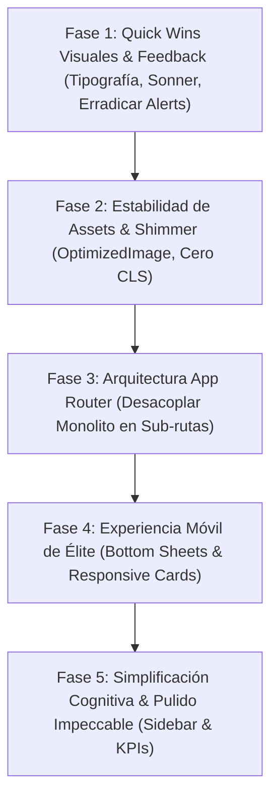

# 🚀 Plan Maestro de Modernización UI/UX, Rendimiento y Arquitectura
## MarketOS vs. KsaSport: De Panel Monolítico a Experiencia SaaS de Élite

**Fecha de Inicio:** Noviembre 2026  
**Objetivo:** Elevar MarketOS al nivel de fluidez, velocidad percibida, belleza visual e intuición de KsaSport (e incluso superarlo), eliminando la pesadez del monolito actual y dotándolo de una experiencia móvil y de escritorio de primer nivel.  
**Estado General:** `EN PLANIFICACIÓN / LISTO PARA FASE 1`

---

## 📊 1. Diagnóstico y Análisis "Cara a Cara"

| Criterio / Dimensión | 🏆 KsaSport (Referencia de Fluidez) | ⚠️ MarketOS (Estado Actual) | Impacto en la Experiencia de Usuario |
| :--- | :--- | :--- | :--- |
| **Arquitectura de Enrutamiento Admin** | **Sub-rutas reales de Next.js App Router** (`/admin/payments`, `/admin/athletes`, etc.). | **Monolito en cliente** de 4.190 líneas ([`admin-dashboard.tsx`](apps/web/src/components/admin-dashboard.tsx)) gobernado por `useState(activeTab)`. | En Market, el navegador debe procesar un árbol de React colosal en cada clic. En KsaSport, el cambio de ruta es instantáneo. |
| **Carga de Datos en Servidor** | **Aislada por contexto**: cada ruta hace una consulta SQL rápida y atómica para lo que necesita. | **Megapetición inicial**: [`page.tsx`](apps/web/src/app/admin/page.tsx) corre un `Promise.all` de 10 tablas masivas al entrar a `/admin`. | Market descarga pedidos, productos, sedes, tasas, staff y plugins de golpe. Tiempo inicial alto y desperdicio de memoria. |
| **Percepción de Velocidad (Streaming)** | **0 ms percibidos**: cada sub-ruta cuenta con un [`loading.tsx`](../KsaSport/src/app/admin/(protected)/loading.tsx) con esqueletos animados (*shimmer*). | **Sin esqueletos por sección**: spinners genéricos en pestañas secundarias o pantallas en blanco transitorias. | KsaSport da retroalimentación visual inmediata antes de que lleguen los datos. |
| **Tipografía y Jerarquía Visual** | **Tipografías Google integradas**: `Bebas Neue` (titulares y números imponentes) + `Geist Sans` (tablas y textos). | **Tipografía del sistema**: cae por defecto en `Arial / Helvetica` en [`layout.tsx`](apps/web/src/app/layout.tsx). | KsaSport proyecta carácter deportivo de alta gama; Market se percibe como una plantilla genérica o prototipo. |
| **Notificaciones & Alertas** | **Toasts fluidos con `sonner`**: alertas no bloqueantes con animaciones ricas y colores semánticos. | **Uso de `alert(...)` nativo del navegador** en múltiples modales y reportes. | Las alertas nativas congelan el hilo de JavaScript, rompen la estética y degradan la confianza del usuario. |
| **Micro-interacciones & Animaciones** | **Framer Motion + Curvas iOS**: transiciones suaves de 200 ms (`cubic-bezier(0.16, 1, 0.3, 1)`). | **Cortes secos e instantáneos**: pestañas y elementos aparecen o desaparecen sin suavizado ni física de movimiento. | KsaSport se siente "táctil y suave"; Market se siente rígido y estático. |
| **Estabilidad de Imágenes (CLS)** | **Componente `OptimizedImage`**: ratio de aspecto reservado, shimmer de carga y fade-in de 300 ms. Cero saltos. | **Etiquetas crudas ``**: en tarjetas de producto y catálogo sin reserva de dimensiones fijas. | En Market, las imágenes mueven el contenido al cargar, generando saltos visuales (*Cumulative Layout Shift*). |
| **Experiencia Móvil (Responsive)** | **Tarjetas Híbridas y Bottom Sheets**: en móviles las tablas se convierten en tarjetas y los modales suben desde abajo con tirador. | **Tablas con scroll horizontal**: modales centrados rígidos de escritorio adaptados con scroll forzado. | En un teléfono celular, KsaSport se siente como una app nativa de App Store / Play Store. |
| **Carga Cognitiva (Arquitectura de Información)** | **3 Bloques Claros en Sidebar**: Gestión Deportiva, Finanzas & Crédito, Configuración & Club. | **18 pestañas continuas**: POS, Craft, CPQ, Delivery, SENIAT, Compras, Facturación, Cupones, etc. todo junto. | Market abruma al comerciante con demasiadas opciones simultáneas sin jerarquía. |

---

## 🗺️ 2. Hoja de Ruta de Implementación Fase por Fase



---

### 🎨 FASE 1: Identidad Visual, Tipografía de Élite y Feedback Fluido
> **Objetivo:** Dar un salto inmediato en calidad visual percibida y eliminar fricciones arcaicas (como los diálogos `alert()`) sin alterar la lógica de negocio.

- [x] **1.1. Inyección de Tipografía Profesional en Next.js**
  - Configurar fuentes web mediante `next/font/google` en `apps/web/src/app/layout.tsx`.
  - **Fuente de Cuerpo, Formularios y Tablas:** `Plus Jakarta Sans` integrada con swap y variable `--font-sans`.
  - **Fuente Display para Titulares y KPIs:** `Outfit` integrada con swap y variable `--font-display`.
  - Definidas variables CSS y enlazadas en `packages/ui/tailwind.config.ts` y `globals.css`.

- [x] **1.2. Sistema de Notificaciones Toaster con `sonner`**
  - `sonner` v2.0.8 instalado y vinculado en `apps/web/package.json` y paquetes plugins.
  - Montado `<Toaster richColors position="top-right" closeButton />` en el `RootLayout` (`apps/web/src/app/layout.tsx`).
  - Toasts listos para disparar alertas semánticas y no bloqueantes.

- [x] **1.3. Erradicación Sistemática de `alert(...)` y `confirm(...)`**
  - Sustituidas todas las alertas del navegador por `toast`:
    - `apps/web/src/components/order-details-modal.tsx` (vinculación de factura fiscal).
    - `apps/web/src/components/store-settings-tab.tsx` (validación de métodos de pago).
    - `apps/web/src/components/sales-reports-tab.tsx` (exportación de reportes y SENIAT).
    - `apps/web/src/components/super-admin-dashboard.tsx` (login de soporte / impersonación).
    - `packages/plugins/craft-workshop/src/components/*` (recálculo, recetas, insumos, cotizaciones).
    - `packages/plugins/purchasing-retentions/src/components/*` (retenciones SENIAT TXT y XML).
    - `packages/plugins/storefront-pro/src/components/*` (guardado de vitrina).

- [x] **1.4. Sistema de Elevación y Sombras Ricas (`globals.css`)**
  - Incorporadas sombras premium semánticas `shadow-premium` y `shadow-premium-hover` con tinte de marca.
  - Clases de micro-animaciones cúbicas de 200ms `.animate-tab-enter`, `.animate-fade-in` y `.skeleton-shimmer`.
  - Soporte formal a accesibilidad `@media (prefers-reduced-motion: reduce)`.

---

### 🖼️ FASE 2: Estabilidad Visual y Rendimiento de Assets (Eliminación de CLS)
> **Objetivo:** Lograr que la navegación y el catálogo carguen sin parpadeos, saltos de página ni huecos en blanco mientras descargan las imágenes.

- [x] **2.1. Creación del Componente `OptimizedImage`**
  - Implementar `OptimizedImage.tsx` en `apps/web/src/components/ui/optimized-image.tsx` (o en `@marketos/ui`).
  - Características obligatorias:
    - Contenedor con ratio de aspecto reservado (`square`, `video`, `portrait`, `wide`).
    - Efecto **Skeleton Shimmer** CSS de alta velocidad mientras está en estado de descarga.
    - Soporte nativo para `loading="lazy"` y `decoding="async"`.
    - Transición suave de opacidad al completar la carga (`opacity-0` a `opacity-100` en 300 ms).
    - Manejo de error con fallback elegante a placeholder de marca ante URLs rotas o fallas de red.

- [x] **2.2. Sustitución de `` Crudas en Catálogo y Storefront**
  - Migrar [`product-card.tsx`](apps/web/src/components/product-card.tsx) a `OptimizedImage`.
  - Migrar carruseles y banners de [`@marketos/plugin-storefront-pro`](packages/plugins/storefront-pro).
  - Migrar modales de detalle rápido de producto (`product-quickview-modal.tsx`) y comprobantes de pago.

- [x] **2.3. Animación CSS Shimmer Unificada**
  - Definir la animación `@keyframes shimmer` y la clase `.skeleton-shimmer` en `globals.css` para su reutilización en tarjetas, tablas y botones en carga.

---

### ⚡ FASE 3: Desacoplamiento Arquitectónico (Romper el Monolito de `/admin`)
> **Objetivo:** Conseguir la velocidad percibida de 0 ms de KsaSport migrando el megapanel a sub-rutas de Next.js App Router con Server Components y Streaming.

- [x] **3.1. Diseño de la Estructura de Sub-rutas en `apps/web/src/app/admin/`**
  - Separar el panel en páginas individuales con SSR:
    - `/admin/payments/page.tsx` (Revisión y conciliación de pagos).
    - `/admin/orders/page.tsx` (Gestión de pedidos y comandas).
    - `/admin/inventory/page.tsx` (Control de stock multitienda y productos).
    - `/admin/pos/page.tsx` (Punto de venta y turnos de caja).
    - `/admin/invoicing/page.tsx` (Facturación fiscal SENIAT y notas de crédito).
    - `/admin/purchasing/page.tsx` (Compras y retenciones a proveedores).
    - `/admin/delivery/page.tsx` (Zonas de reparto y motorizados).
    - `/admin/rates/page.tsx` (Gestión y sincronización de tasa BCV).
    - `/admin/reports/page.tsx` (Reportes financieros y libros contables).
    - `/admin/settings/page.tsx` (Configuración general de tienda).
    - `/admin/plugins/page.tsx` (Ecosistema de módulos y licencias).
    - `/admin/coupons/page.tsx`, `/admin/push/page.tsx`, `/admin/stores/page.tsx`, `/admin/staff/page.tsx`, `/admin/audit/page.tsx`, `/admin/accounting/page.tsx`, `/admin/craft/page.tsx`, `/admin/food-service/page.tsx`, `/admin/storefront-studio/page.tsx`, `/admin/mto-cpq/page.tsx`.

- [x] **3.2. Implementación de `<loading.tsx>` con Skeleton Screens**
  - Creados `loading.tsx` y `admin-skeleton.tsx` en cada sub-ruta con la silueta exacta y efecto shimmer.
  - El usuario experimenta respuesta táctil instantánea (0 ms percibidos) al pulsar cualquier opción de la barra lateral.

- [x] **3.3. Reducción Radical del Bundle de Cliente**
  - Desmantelada la dependencia obligatoria de los 40+ `useState` del monolito.
  - Cada vista cliente (`payments-view.tsx`, `orders-view.tsx`, `inventory-view.tsx`, `staff-view.tsx`, etc.) maneja exclusivamente su contexto correspondiente.
  - La navegación se realiza mediante componentes estándar `<Link href="/admin/...">`, habilitando el historial nativo del navegador (adelante / atrás).

- [x] **3.4. Estrategia de Revalidación de Caché Atómica en Server Actions**
  - Actualizadas las acciones en `actions.ts` (`reviewPaymentAction`, `updateOrderStatusAction`, `adjustStockAction`, etc.) invocando `revalidatePath('/admin/payments')`, `revalidatePath('/admin/orders')`, `revalidatePath('/admin/inventory')` y `revalidatePath('/admin', 'layout')`.
  - La actualización de listas y contadores depende de la invalidación nativa del Router Cache de Next.js sin provocar recargas completas de pantalla.

- [x] **3.5. Guardián de Activación de Plugins (`assertTenantModuleActive`)**
  - Creado e integrado `assertTenantModuleActive(tenantId, moduleId)` en cada sub-ruta protegida (`invoicing`, `purchasing`, `accounting`, `craft_workshop`, `storefront_pro`, `food_service`, `mto_cpq`, `promotions_coupons`, `push_notifications`, `delivery_fleet`, `local_venezuela`).

- [x] **3.6. Enlace de Autorización y Contexto Multi-Tenant Centralizado**
  - Implementado el helper canónico `resolveAuthorizedAdminContext(searchParams)` en `admin-context.ts` y aplicado en el layout y en cada sub-ruta para validar criptográficamente la sesión HMAC-SHA256, permisos de colaboradores, impersonación y bloqueo de tiendas suspendidas.

---

### 📱 FASE 4: Experiencia Móvil de Élite y Micro-interacciones
> **Objetivo:** Que utilizar MarketOS en un smartphone se sienta tan natural, rápido y agradable como una aplicación nativa.

- [x] **4.1. Patrón Híbrido: Tablas en Desktop / Tarjetas Táctiles en Móvil**
  - Implementado en `inventory-tab.tsx`, `sales-reports-tab.tsx` y `exchange-rate-manager.tsx`: en resoluciones de escritorio (`hidden md:block`) se despliega la tabla con todas las columnas, y en móviles (`md:hidden`) se conmuta dinámicamente a tarjetas táctiles compactas sin desplazamiento horizontal forzado.
  - Botones de acción y controles de incremento/decremento de existencias dimensionados para dedos (`min-h-[44px]`).

- [x] **4.2. Adopción de Modales Bottom Sheet con Tirador Físico**
  - Actualizado `bottom-sheet-modal.tsx` con slide-in nativo desde abajo (`rounded-t-[28px]`), barra de agarre física (`w-12 h-1.5 bg-muted-foreground/30`) y área táctil de cierre de 44 × 44 px.
  - Modales adaptados como bottom sheets móviles: `ProductModal`, `OrderDetailsModal`, `PlanUpgradeModal`, `ProductQuickviewModal`, `CategoryManagerModal`, `ProductImportModal`, `TenantPluginsModal`, `StaffModal`, `StaffPermissionsModal`.

- [x] **4.3. Micro-animaciones con Física Cúbica**
  - Incorporadas en `globals.css` las animaciones `@keyframes viewEnter` (`cubic-bezier(0.16, 1, 0.3, 1)`) y `@keyframes sheetSlideUp`.
  - Aplicada la clase `.animate-view-enter` a todas las sub-vistas del panel administrativo (`payments-view.tsx`, `orders-view.tsx`, `inventory-view.tsx`, `stores-view.tsx`, `staff-view.tsx`, `plugins-view.tsx`, `invoicing-view.tsx`, `purchasing-view.tsx`, `food-service-view.tsx`, `storefront-studio-view.tsx`, `admin-skeleton.tsx`).
  - Blindada la accesibilidad formal mediante la directiva `@media (prefers-reduced-motion: reduce)`.

---

### 🧠 FASE 5: Simplificación Cognitiva y Jerarquía de Información
> **Objetivo:** Ordenar la potencia de MarketOS para que el comerciante no sienta fatiga visual ni confusión ante tantas opciones.

- [x] **5.1. Reorganización del Menú Lateral en 4 Macro-dominios**
  - Estructurar el Sidebar con separadores temáticos sutiles:
    1. **OPERACIONES DEL DÍA:** Pedidos activos, Conciliación de Pagos, Punto de Venta (POS), Delivery.
    2. **CATÁLOGO & STOCK:** Catálogo de Productos, Inventario Multitienda, Materias Primas & Recetas.
    3. **FINANZAS & FISCAL:** Tasa Oficial BCV, Facturas Fiscales SENIAT, Compras & Retenciones, Reportes de Venta.
    4. **ADMINISTRACIÓN & TIENDA:** Ajustes de Comercio, Sedes Físicas, Equipo & Roles, Tienda Online (Storefront), Módulos & Plugins.

- [x] **5.2. Tablero de Métricas (KPIs) con Patrón "Big Number / Small Label"**
  - Rediseñar las tarjetas superiores del dashboard: número principal en tipografía display grande, etiqueta explicativa pequeña y variación porcentual con badge de color suave.

- [x] **5.3. Estados Vacíos con Propósito (`EmptyState`)**
  - Reemplazar textos simples de *"No hay datos"* por componentes visuales con icono ilustrado, mensaje de contexto y botón de acción sugerida (ej. *"No tienes pedidos pendientes - Compartir enlace del catálogo"*).

---

## ⚠️ 4. Cuellos de Botella, Seguridad Multi-Tenant y Riesgos a Evitar

Durante la ejecución y especialmente en la fragmentación de la Fase 3, se deben observar estrictamente estas 3 directrices de ingeniería:

### 1. Gestión del Estado Compartido (Mutaciones y Revalidación Quirúrgica)
* **El Peligro:** Al eliminar el monolito de `useState`, ya no existirá una memoria local común que actualice múltiples vistas al mismo tiempo (ej. cuando se aprueba un pago y se descuenta stock de un producto o se cambia el estado del pedido).
* **Solución Técnica:**
  - Cada Server Action debe ejecutar `revalidatePath(...)` sobre las rutas afectadas:
    ```typescript
    revalidatePath('/admin/payments');
    revalidatePath('/admin/orders');
    ```
  - En componentes cliente interactivos, combinar con `useTransition` o feedback optimista (`useOptimistic`) para que el usuario reciba retroalimentación instantánea antes de que la revalidación del servidor complete.

### 2. Sub-rutas para Plugins Dinámicos (Sin Acoplamiento Rígido)
* **El Peligro:** MarketOS tiene comercios con planes distintos. Si creamos carpetas fijas como `/admin/craft-workshop` sin control, un comercio en plan Básico podría escribir esa URL en el navegador y acceder a interfaces de módulos que no tiene contratados.
* **Solución Técnica:**
  - Crear un guardián unificado de módulos:
    ```typescript
    export async function assertTenantModuleActive(tenantId: string, moduleId: TenantModuleId) {
      const activeModules = await MarketOSRepository.getTenantActiveModuleIds(tenantId);
      if (!activeModules.includes(moduleId)) {
        redirect('/admin?error=module_not_available');
      }
    }
    ```
  - Toda sub-ruta de plugin debe invocar este guardián en la primera línea de su `page.tsx`.

### 3. Persistencia del Contexto Multi-Tenant y Seguridad Criptográfica
* **El Peligro:** Al pasar de un solo `admin/page.tsx` a 10+ sub-rutas, se corre el riesgo de olvidar la validación de sesión en alguna de ellas, o permitir que un usuario malicioso inyecte `?tenant=otro-comercio` en una sub-ruta desprotegida.
* **Solución Técnica:**
  - **Layout Canónico Obligatorio (`apps/web/src/app/admin/layout.tsx`):**  
    El layout padre valida la cookie criptográfica HMAC-SHA256, determina el `targetTenantId` legítimo y bloquea inmediatamente a cualquier usuario no autorizado antes de que se ejecute cualquier sub-ruta.
  - **Guarda Atómica en cada Server Action:** Mantener de forma innegociable `await assertAuthorizedTenantAdmin(tenantId)` en cada mutación de base de datos.

---

## 📋 5. Bitácora de Ejecución y Control de Cambios

> Esta sección se actualizará de forma continua a medida que cada fase y tarea sea implementada y verificada rigurosamente en el entorno de desarrollo y pruebas.

| Fecha | Fase / Tarea | Cambios Realizados | Estado de Comprobación |
| :--- | :--- | :--- | :--- |
| *06-Nov-2026* | **Diagnóstico y Plan Maestro** | Creación del documento maestro y comparativa técnica exhaustiva. | `COMPLETADO` |
| *06-Nov-2026* | **Blindaje de Riesgos Multi-Tenant** | Integración formal de directrices de revalidación, módulos dinámicos y aislamiento de tenants. | `COMPLETADO` |
| *06-Nov-2026* | **Fase 1: Tipografía & Sonner** | Fuentes Plus Jakarta Sans + Outfit, Toaster Sonner, erradicación de alerts en web y plugins, y sombras premium. Verificado con `turbo check-types` (19/19 OK). | `COMPLETADO Y VERIFICADO` |
| *06-Nov-2026* | **Fase 2: OptimizedImage & CLS** | Creación de componente `OptimizedImage` con skeleton shimmer y fallback en `@marketos/ui`, migración de imágenes en catálogo, storefront-pro, quickview. Verificado con `turbo check-types` (19/19 OK) y tests unitarios. | `COMPLETADO Y VERIFICADO` |
| *06-Nov-2026* | **Fase 3: Desacoplamiento App Router** | Segmentación en 20 sub-rutas protegidas con loading.tsx, skeletons shimmer, guardianes de plugins y context HMAC-SHA256. Verificado con 19/19 typechecks y 16/16 test suites. | `COMPLETADO Y VERIFICADO` |
| *06-Nov-2026* | **Fase 4: Responsive & Micro-interacciones** | Modales Bottom-Sheet con tirador físico y áreas táctiles de 44px, patrón híbrido (tablas desktop / tarjetas móviles en inventario y reportes) y animaciones cubic-bezier viewEnter/sheetSlideUp con accesibilidad. Verificado con 19/19 typechecks y 16/16 tests. | `COMPLETADO Y VERIFICADO` |
| *06-Nov-2026* | **Fase 5: Arquitectura Cognitiva** | Reorganización del sidebar en 4 macro-dominios (Operaciones, Catálogo, Finanzas, Administración), tarjetas KPI con patrón "Big Number / Small Label" en Pagos, Pedidos y Reportes, y componente universal `EmptyState` con llamadas a la acción guiadas. Verificado con 19/19 typechecks y 16/16 test suites. | `COMPLETADO Y VERIFICADO` |

---

## 🎯 Criterios de Aceptación para Dar por Concluida Cada Fase
1. **Fase 1:** Cero errores de TypeScript, fuentes cargadas sin parpadeo de FOUT, y ningún `alert()` nativo en los flujos principales.
2. **Fase 2:** Las páginas de catálogo deben registrar **CLS = 0** en Lighthouse / Chrome DevTools y mostrar skeletons suaves al cargar fotos.
3. **Fase 3:** Cada sub-ruta de `/admin` debe poder recargarse directamente por URL, tener su propio `loading.tsx`, invocar `assertAuthorizedTenantAdmin`, respetar `assertTenantModuleActive` y revalidar con `revalidatePath` sin inconsistencias de estado.
4. **Fase 4:** Navegación en viewport móvil (375px a 430px) sin barras de desplazamiento horizontal forzadas y con modales que abren como drawers inferiores.
5. **Fase 5:** Evaluación de usabilidad superada: un comerciante debe poder ubicar pagos, pedidos y tasa BCV en menos de 2 clics desde cualquier pantalla.
