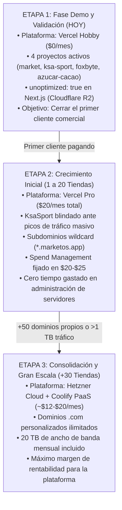

# Hoja de Ruta de Escalabilidad e Infraestructura (MarketOS & KsaSport)

> **Documento Estratégico de Infraestructura y Costos a Largo Plazo**  
> **Objetivo:** Definir la evolución del hosting desde la **Fase Demo ($0)** hasta un entorno **Multi-Tienda con Alto Tráfico**, evaluando **Vercel Pro**, **Render** y la migración a **VPS Dedicado (Hetzner + Coolify)**.

---

## 1. Contexto y Ecosistema de Proyectos

Actualmente tu cuenta de Vercel concentra **4 proyectos reales en producción**:
1. **`market`** (`market-sable-iota.vercel.app`): MarketOS (Monorepo Turborepo con tienda, admin y superadmin multi-tenant).
2. **`ksa-sport`** (`ksa-sport.vercel.app`): E-commerce deportivo con **alto tráfico**.
3. **`foxbyte`** (`foxbyte-chi.vercel.app`).
4. **`azucar-cacao`** (`azucar-cacao.vercel.app`).

Ambos pilares de crecimiento son **KsaSport** (demanda de tráfico y picos de venta) y **MarketOS** (arquitectura multi-tienda SaaS).

---

## 2. Comparativa de Plataformas para este Ecosistema

### A. Vercel (Plan Pro - $20 / mes)
* **Modelo de cobro:** \$20/mes por desarrollador (aloja todos los proyectos de tu equipo bajo un mismo pago).
* **Rendimiento Next.js 16:** **Nativo 100%**. Soporte directo para Server Actions, App Router y streaming SSR sin configuraciones.
* **Escalabilidad ante tráfico alto:** **Serverless automático**. Si KsaSport o una tienda de MarketOS recibe 2.000 visitas al mismo segundo en una promoción, Vercel despliega 2.000 instancias instantáneas. No se satura ni se congela.
* **Disponibilidad:** 99.99% en red Edge global (Anycast CDN en +300 ciudades). **Nunca se duerme**.
* **Limitaciones clave:**
  * 50 dominios personalizados por proyecto (los subdominios `*.marketos.app` son ilimitados).
  * 1 TB de transferencia mensual incluido (muy amplio si las imágenes se sirven desde Cloudflare R2).

### B. Render (No recomendado para Next.js 16)
* **Plan Free:**
  * Los contenedores **se duermen tras 15 min de inactividad** y tardan **50 a 90 segundos en arrancar**. Pésimo para demos con clientes.
  * Límite de 512 MB de RAM que provoca errores de *Out of Memory* al compilar Next.js 16.
* **Planes de Pago:**
  * Cobra **por cada servicio individualmente** ($7 a $19/mes por cada app). Para MarketOS (`web`, `admin`, `super-admin`) serían entre **$21 y $40/mes solo en hosting**.
  * Servidores fijos con CPU y memoria limitadas. Ante un pico de tráfico de KsaSport, el servidor se satura a menos que se escale manualmente pagando más.

### C. VPS Dedicado (Hetzner + Coolify / Docker - La meta a gran escala)
* **Costo:** Servidor VPS en Hetzner (ej. 4 vCPUs, 8 GB RAM, 160 GB NVMe, 20 TB tráfico) por **~€8 a €12 / mes**.
* **Capacidad:**
  * Dominios personalizados **ilimitados** para todas las tiendas de MarketOS.
  * **20 Terabytes de tráfico** (20 veces más que Vercel Pro).
  * Aloja KsaSport, MarketOS y cualquier otro proyecto sin coste adicional por contenedor.
* **Desventaja:** Requiere administración de servidor (backups, parches de seguridad de Linux, supervisión de memoria y configuración de balanceadores para picos de tráfico).

---

## 3. ¿Hasta Dónde Rinde Vercel Pro ($20/mes)?

Vercel Pro es la mejor solución durante la fase de crecimiento por las siguientes métricas:

| Recurso en Vercel Pro | Capacidad Real | Impacto en KsaSport y MarketOS |
| :--- | :--- | :--- |
| **1 TB de Ancho de Banda** | 500.000 a 1.000.000 de visitas/mes | Las imágenes pesadas ya están en Cloudflare R2 ($0 egress), por lo que las páginas HTML/JS de Next.js consumen muy poco ancho de banda. |
| **Serverless Invocations** | Millones de ejecuciones al mes | Absorbe sin problemas campañas de marketing o picos de venta de KsaSport. |
| **Dominios Wildcard** | Ilimitados (`*.marketos.app`) | Puedes crear `tienda1.marketos.app`, `tienda2.marketos.app` sin gastar la cuota de dominios. |
| **Dominios Custom** | Hasta 50 dominios `.com` | Suficiente para las primeras 50 tiendas que exijan dominio propio independiente. |

---

## 4. Los Detonantes Exactos para Migrar de Vercel a un VPS

Debes dar el paso de migrar a un VPS (Hetzner + Coolify) **únicamente cuando se cumpla alguna de estas condiciones**:

1. **Superas las 30 a 50 tiendas con dominios personalizados propios:**  
   Cuando más de 50 comercios te exijan su propio `.com` (`mitienda.com`, `supermarket.com`) y Vercel te pida subir a plan Enterprise.
2. **KsaSport + MarketOS superan 1 Terabyte de transferencia mensual:**  
   Cuando el tráfico combinado sea tan masivo que el ancho de banda adicional en Vercel resulte más costoso que mantener un servidor dedicado.
3. **El negocio ya factura sólidamente ($500 - $1.500+ USD/mes):**  
   Cuando los ingresos recurrentes de las tiendas justifiquen dedicar horas a gestionar y monitorear un servidor propio.

---

## 5. Hoja de Ruta Estratégica en 3 Etapas

---

## 6. Recomendaciones Técnicas Inmediatas

1. **Mantener `unoptimized: true` para fotos de catálogo:**
   Las imágenes de productos se almacenan en Cloudflare R2 y se sirven directamente desde su CDN global. Esto evita que Vercel te cobre \$5 por cada 1.000 imágenes procesadas.
2. **Aprovechar la caché ISR en KsaSport y MarketOS:**
   Configurar `revalidate` en las páginas de catálogo y productos para que Next.js las mantenga en caché estática en el Edge, reduciendo el consumo de base de datos y de CPU a casi cero.
3. **Subdominios como estándar inicial:**
   Ofrece a cada tienda nueva su URL personalizada bajo `nombredetienda.marketos.app` (esto no consume cuota de dominios en Vercel y es instantáneo de configurar vía DNS).
